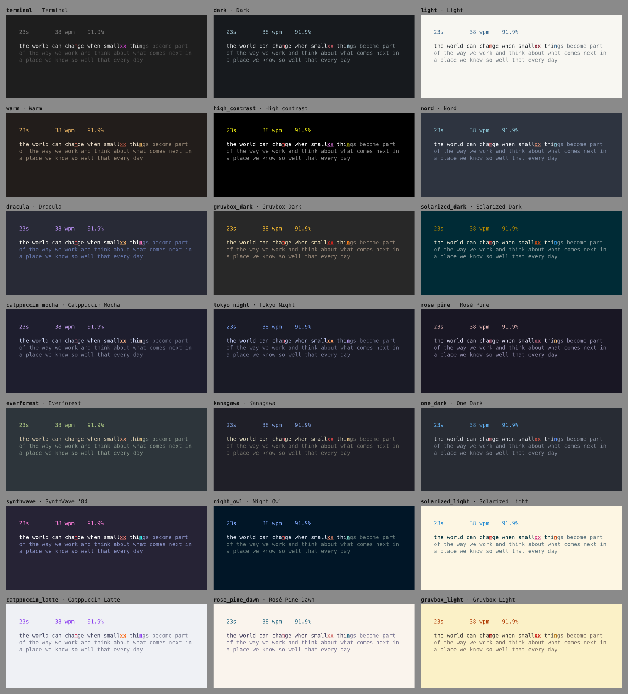

# Themes

Clack ships 21 themes. The default `terminal` theme follows your terminal's own
colors. Four Clack originals sit beside it: `dark`, `light`, `warm`, and
`high_contrast`. The other sixteen adapt classic open-source color schemes.
Every theme styles the whole interface: typing, results, test setup, commands,
history, review, and help.



## Choosing a theme

Open commands with **Esc** or **Ctrl-P** and type `theme`. Moving onto a theme
entry previews it immediately across the whole screen. **Enter** saves it, and
**Esc** closes commands and restores the previous theme. Each entry ends with a
swatch of that theme's background, text, accent, and caret colors. Search terms
match names, labels, and variants, so `theme light` lists every light theme and
`theme gruv` finds both Gruvbox themes. The **Theme** setting offers the same
choices with the same live preview.

```sh
clack --theme nord           # This session only; the configuration is unchanged
clack themes list            # Configuration names, one per line
clack themes show            # Every theme as a colored sample
clack themes show dracula --json
```

To keep a theme without the palette, set it in the configuration file:

```toml
[appearance]
theme = "catppuccin_mocha"

[workflow]
favorite_themes = ["catppuccin_mocha", "nord"]   # marked with * in commands
```

`clack themes show` follows the color policy: piped output stays plain unless
you pass `--color always`. Its `--json` form describes every role with the
authored 24-bit color, the xterm-256 entry actually used, and the 16-color
stand-in, plus the palette's source and license.

## Shipped themes

| Name | Theme | Variant | Palette |
|---|---|---|---|
| `terminal` | Terminal: your terminal's own colors | follows the terminal | Clack |
| `dark` | Dark: quiet slate, steel-blue accent | dark | Clack |
| `light` | Light: warm paper, ink-blue accent | light | Clack |
| `warm` | Warm: ember brown with an amber glow | dark | Clack |
| `high_contrast` | High contrast: maximum legibility | dark | Clack, terminal colors |
| `nord` | Nord: arctic, north-bluish calm | dark | [Nord](https://www.nordtheme.com) |
| `dracula` | Dracula: vivid purple and pink at night | dark | [Dracula](https://draculatheme.com) |
| `gruvbox_dark` | Gruvbox Dark: retro groove, warm earth tones | dark | [Gruvbox](https://github.com/morhetz/gruvbox) |
| `solarized_dark` | Solarized Dark: precise teal, golden accents | dark | [Solarized](https://ethanschoonover.com/solarized/) |
| `catppuccin_mocha` | Catppuccin Mocha: soothing pastels on mocha | dark | [Catppuccin](https://catppuccin.com) |
| `tokyo_night` | Tokyo Night: neon city lights on indigo | dark | [Tokyo Night](https://github.com/enkia/tokyo-night-vscode-theme) |
| `rose_pine` | Rosé Pine: dusky rose and gold | dark | [Rosé Pine](https://rosepinetheme.com) |
| `everforest` | Everforest: soft sage of a quiet forest | dark | [Everforest](https://github.com/sainnhe/everforest) |
| `kanagawa` | Kanagawa: ink and waves after Hokusai | dark | [Kanagawa](https://github.com/rebelot/kanagawa.nvim) |
| `one_dark` | One Dark: the classic Atom editor look | dark | [One Dark](https://github.com/atom/atom) |
| `synthwave` | SynthWave '84: retro neon from a night drive | dark | [SynthWave '84](https://github.com/robb0wen/synthwave-vscode) |
| `night_owl` | Night Owl: deep ocean blue for night owls | dark | [Night Owl](https://github.com/sdras/night-owl-vscode-theme) |
| `solarized_light` | Solarized Light: precise teal ink on cream | light | Solarized |
| `catppuccin_latte` | Catppuccin Latte: soothing pastels on latte | light | Catppuccin |
| `rose_pine_dawn` | Rosé Pine Dawn: morning parchment, pine and rose | light | Rosé Pine |
| `gruvbox_light` | Gruvbox Light: retro groove on faded paper | light | Gruvbox |

Adapted themes use the colors published by each upstream project. Which color
fills which role, and the few blended tones noted in the source, are Clack's
choices. Their MIT notices are in [THIRD-PARTY-NOTICES.md](../THIRD-PARTY-NOTICES.md).
Monkeytype offers many of the same schemes, but Clack's versions come from the
upstream projects, not from Monkeytype's theme files.

## What each color does

Every theme defines the same ten roles:

| Role | Where it appears |
|---|---|
| background | The whole screen |
| surface | The bar behind a selected setup, command, or history row |
| text | Typed text, headings, and primary labels |
| subtext | Text still to be typed |
| muted | Hints and secondary labels |
| accent | The live timer and speed, result figures, selected rows, the speed chart |
| caret | The next character to type |
| error | A wrong character, shown as typed |
| extra | Characters typed past the end of a word |
| pace | The pace caret |

Color is never the only cue. Wrong characters are underlined (or reversed when
`error_underline = false`), extra characters are also bold, and the caret is
underlined and bold. Monochrome output keeps all of these. The `terminal` theme
keeps its quiet status line and uses terminal palette colors throughout, so it
matches whatever color scheme your terminal already uses.

## Color depth

Clack selects the richest color depth that it can confidently detect:

- **24-bit** when `COLORTERM` is `truecolor` or `24bit`, when `TERM` ends in
  `-direct` or names kitty, Ghostty, Alacritty, WezTerm, or foot, and in Windows
  Terminal (`WT_SESSION`) unless `TERM` shows screen or tmux in between.
- **256 colors** when `TERM` contains `256color`. Each tone uses the perceptually
  nearest entry of the standard xterm color cube or gray ramp, measured in OKLab.
  Entries 0–15 are never used here because terminals redefine them. A few
  tones pin an entry instead: Solarized uses its own published approximations,
  and the original themes keep their earlier background, text, and accent
  entries.
- **16 colors** otherwise. Each tone names a terminal palette color. Dark themes
  use black backgrounds with white text, light themes the reverse, and text
  still to be typed is also dimmed.
- **No color** with `NO_COLOR` or `--color never`. `--color always` overrides
  `NO_COLOR`.

`clack doctor --json` reports the detected depth. If your terminal supports
24-bit color without advertising it, set `COLORTERM=truecolor`; SSH usually does
not forward that variable. Inside tmux, set it in the session and enable tmux's
`RGB` terminal feature so 24-bit color reaches the outer terminal.

## Readability checks

Automated tests hold every painted theme to measured contrast against its
background, using the WCAG ratio:

| Role | 24-bit | 256-color |
|---|---|---|
| Typed text | 7.0:1 | 6.0:1 |
| Text still to type, accent, caret, error | 3.0:1 | 2.8:1 |
| Hints, extra characters, pace caret | 2.5:1 | 2.3:1 |
| Accent on the selection bar | 3.0:1 | 2.6:1 |

Typed and untyped text must also differ by at least 1.6:1. Pairs that must not be
confused, such as accent and error or error and extra, must stay measurably
different after 256-color quantization. Every role at every depth is recorded in
[`tests/snapshots/themes.txt`](../tests/snapshots/themes.txt), so palette changes are reviewed like
other visible output. These checks do not replace looking at a theme in a real
terminal and font.

## Adding a theme

1. Add a `ThemeSpec` to `src/ui/theme/catalog.rs`. It needs a lowercase
   `snake_case` name, a label, a description of at most 32 characters, a
   variant, a credit for adapted palettes, and ten tones. Each tone needs a
   16-color stand-in that follows the convention described above.
2. Run `cargo test`. The theme tests report any contrast, distinctness, or
   16-color convention failure. Pin an xterm-256 entry with `.indexed(n)` only
   where the derived match loses the theme's character; a pin equal to the
   derived match is rejected.
3. Regenerate and review the outputs:

   ```sh
   CLACK_UPDATE_SNAPSHOTS=1 cargo test --test ui_product_snapshots
   COLORTERM=truecolor cargo run --example theme_gallery > docs/images/themes.svg
   ```

4. Add the palette's license notice to `THIRD-PARTY-NOTICES.md` and a row to the
   table above.
